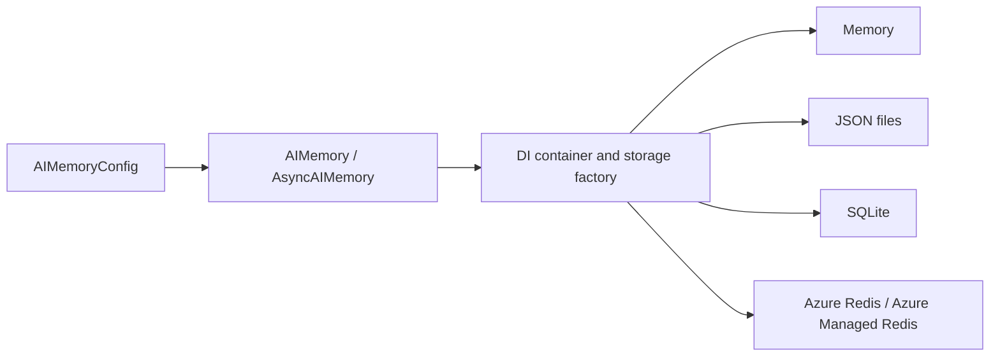

# Architecture

## Public APIs

`nexamem.AIMemory` and `nexamem.AsyncAIMemory` are the configuration-driven facades. They use `AIMemoryConfig`, a dependency-injection container, and `BaseStorage`/`BaseAsyncStorage` implementations. The storage factory selects a backend from `StorageConfig`.

The generic facade API is `store`, `retrieve`, `delete`, `list`, `search`, `purge_expired`, `get_audit_log`, `get_stats`, and `clear_scope`. Storage adapters expose `list_memories` internally. Async equivalents are awaitable. Content is text, metadata is a dictionary, and generic scopes are caller-supplied strings.



## Compatibility Channels

Channel YAML and `register_channel()` configure the facade's compatibility `write()`/`read()` methods. They store channel metadata alongside generic memory records. The scope key is `env:agent_id:user_id:session_id:channel`.

The new facade enforces channel TTL and positive `ttl_override` through portable per-record logical expiry. It does not automatically invoke `PolicyEngine`, `ContentProcessorChain`, Redis checkpoint helpers, or Redis bulk-erase helpers. Quota, encryption, and PII options do not activate those policies. Compatibility reads apply `max_msgs`; time, byte, and token limits are not applied.

The retained `LegacyAIMemory`/`LegacyAsyncAIMemory` classes use a different Redis-oriented path. See [legacy APIs](LEGACY_API.md). Namespace keys are not access control; applications must authorize every operation.

## Local Storage

| Backend | Persistence | Limitations |
| --- | --- | --- |
| Memory | None beyond the process | No background physical expiry or durable audit retention |
| File | Individual JSON records plus scope/audit indexes | Atomic record replacement, but no transaction across record/index/audit files; coordinate concurrent writers |
| SQLite | Database records and audit rows | Synchronous engine; async data operations offloaded to worker threads |

Overwrites preserve creation time and update scope indexes. SQLite connections used by the storage adapter are closed explicitly. File/SQLite async data operations use `asyncio.to_thread` with a per-adapter lock held until the worker finishes, even through repeated cancellation. Cancellation is not rollback; a cancelled write may complete. Constructors initialize synchronously. Per-instance locks do not coordinate other processes or adapter instances.

File identifiers are percent-encoded to prevent directory traversal and support Windows reserved names. Case-insensitive collisions and filesystem filename-length limits still apply. Review [migration notes](LEGACY_API.md) before opening older file stores.

## Retention and Lifecycle

`AIMemoryConfig(default_ttl_sec=...)` sets a positive generic default; `NEXAMEM_DEFAULT_TTL_SEC` supplies it through environment configuration. `store(..., ttl_sec=...)` overrides it. `None` uses the default, not an explicit exemption; without a default or override, generic records persist. Compatibility `write()` uses the registered channel TTL or a positive `ttl_override`.

The facade stores a Unix expiry timestamp in reserved metadata `_nexamem_expires_at`; callers must not supply that field. Existing records without it remain nonexpiring. Overwriting a record assigns the new write's expiry. Invalid or nonfinite persisted expiry values are treated as expired. Returned metadata includes this internal field.

`retrieve`, `list`, `search`, and compatibility `read` hide expired records and attempt deletion on access. Limits apply after expiry filtering. `purge_expired(scope=...)` deletes expired records in one scope; omitting the scope scans **all** scopes, not just the configured default. `get_stats()` purges expired records before computing stats. Audit logs and backups are not covered. Direct backend and legacy reads bypass facade expiry.

This is read-time visibility filtering, not a physical-deletion SLA, background scheduler, or transactional protection against concurrent reads/overwrites. Scans add retrieval and deletion I/O; plan capacity and an application-owned cleanup schedule for large stores. Coordinate concurrent writers if expiry deletion must not race a replacement. Authorize cleanup access as carefully as reads.

Facades and storage bases support context managers. `AIMemory.close()` and `AsyncAIMemory.aclose()`/`close()` release facade-created storage. DI-registered storage is borrowed and must be closed by its owner. Local backends have no persistent connection handle to close. Stop concurrent operations before teardown.

## Azure Redis Configuration

Accepted endpoints are `.redis.cache.windows.net` (default TLS port `6380`) and `.redis.azure.net` (Managed Redis, default TLS port `10000`, database `0` only). An explicit port takes precedence; TLS is required. This is a standalone/proxy `Redis` client, not `RedisCluster`; OSS-cluster routing is not implemented.

```python
import os
from nexamem import AIMemoryConfig, AzureRedisConfig, StorageConfig

config = AIMemoryConfig(
    default_scope="application",
    storage=StorageConfig.azure_redis(
        AzureRedisConfig(
            hostname=os.environ["AZURE_REDIS_HOSTNAME"],
            auth_method="entra_id",
            use_entra_id=True,
            client_id=os.environ.get("AZURE_CLIENT_ID"),
        )
    ),
)
```

This only constructs configuration. Connecting requires network access, Redis data-plane permissions, and real credentials supplied outside source control. See [Azure setup](INSTALLATION.md#azure-cache-for-redis) for managed identity, environment selection, and Key Vault alternatives.

Entra mode uses redis-entraid streaming credentials, token-derived object-ID usernames, and renewal callbacks. The facade owns credentials and renewal cleanup. Async token acquisition offloads synchronous Azure identity requests. Explicit complete service-principal credentials remain supported, but managed identity is preferred. The owned token manager extends protected SDK internals, so dependency upgrades require renewal/lifecycle regression tests. Key Vault mode accepts `auth_method="keyvault"`, `keyvault_url`, and `secret_name`; reconnect to load rotated secrets.

The optional Redis collection helpers keep payloads in an environment/agent hash and channel indexes in sorted sets. Their TTL applies to the shared hash/index keys, not individual messages. A later write can extend other messages' lifetime. Checkpoints are environment/agent scoped, not user/session scoped. Audit streams use refreshed whole-stream TTL, not immutable per-record retention.

TLS certificate verification is enabled on the repaired Redis paths. These unit tests use fakeredis and mocked identity services; they do not verify a live Azure service or guarantee throughput, latency, compliance, encryption at rest, or tenant isolation.

## Framework Boundaries

Optional adapters preserve framework message serialization while using the public facades for storage and expiry. They do not provide embeddings, vector retrieval, distributed ordering, or transactional history batches. See [integration contracts and Foundry hosting](INTEGRATIONS.md).