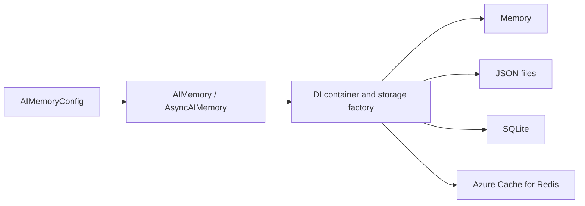

# Architecture

## Public APIs

`nexamem.AIMemory` and `nexamem.AsyncAIMemory` are the configuration-driven facades. They use `AIMemoryConfig`, a dependency-injection container, and `BaseStorage`/`BaseAsyncStorage` implementations. The storage factory selects a backend from `StorageConfig`.

The generic facade API is `store`, `retrieve`, `delete`, `list`, `search`, `get_audit_log`, `get_stats`, and `clear_scope`. Storage adapters expose `list_memories` internally. Async equivalents are awaitable. Content is text, metadata is a dictionary, and generic scopes are caller-supplied strings.



## Compatibility Channels

Channel YAML and `register_channel()` configure the facade's compatibility `write()`/`read()` methods. They store channel metadata alongside generic memory records. The scope key is `env:agent_id:user_id:session_id:channel`.

Configuration validation is not runtime policy enforcement. The new facade does not automatically invoke `PolicyEngine`, `ContentProcessorChain`, Redis checkpoint helpers, or Redis bulk-erase helpers. TTL, quota, encryption, and PII options do not activate those features in generic CRUD or compatibility writes. Compatibility reads apply `max_msgs`; time, byte, and token limits are not applied.

The retained `LegacyAIMemory`/`LegacyAsyncAIMemory` classes use a different Redis-oriented path. See [legacy APIs](LEGACY_API.md). Namespace keys are not access control; applications must authorize every operation.

## Local Storage

| Backend | Persistence | Limitations |
| --- | --- | --- |
| Memory | None beyond the process | No automatic expiry or durable audit retention |
| File | Individual JSON records plus scope/audit indexes | Atomic record replacement, but no transaction across record/index/audit files; coordinate concurrent writers |
| SQLite | Database records and audit rows | Local synchronous I/O; no automatic generic memory expiry |

Overwrites preserve creation time and update scope indexes. SQLite connections used by the storage adapter are closed explicitly. Local async adapters wrap synchronous operations and may block the event loop.

File identifiers are percent-encoded to prevent directory traversal and support Windows reserved names. Case-insensitive collisions and filesystem filename-length limits still apply. Review [migration notes](LEGACY_API.md) before opening older file stores.

## Azure Redis Configuration

Azure Cache for Redis hostnames currently must end in `.redis.cache.windows.net`. Azure Managed Redis hostname compatibility is not implemented.

```python
import os
from nexamem import AIMemoryConfig, AzureRedisConfig, StorageConfig

config = AIMemoryConfig(
    default_scope="application",
    storage=StorageConfig.azure_redis(
        AzureRedisConfig(
            hostname=os.environ["AZURE_REDIS_HOSTNAME"],
            access_key=os.environ["AZURE_REDIS_ACCESS_KEY"],
        )
    ),
)
```

This only constructs configuration. Connecting requires network access, service-side permissions, and real credentials supplied outside source control. See [Azure setup](INSTALLATION.md#azure-cache-for-redis) for a Key Vault-backed example using application identity to retrieve the Redis access key.

The schema also accepts `auth_method="entra_id"` with `use_entra_id=True`, but the adapter does not forward the configured Redis username or renew tokens. These fields do not establish production-ready direct Entra ID Redis authentication. Key Vault mode accepts `auth_method="keyvault"`, `keyvault_url`, and `secret_name`; reconnect to load rotated secrets. Validate credential lifecycle for your deployment.

The optional Redis collection helpers keep payloads in an environment/agent hash and channel indexes in sorted sets. Their TTL applies to the shared hash/index keys, not individual messages. A later write can extend other messages' lifetime. Checkpoints are environment/agent scoped, not user/session scoped. Audit streams use refreshed whole-stream TTL, not immutable per-record retention.

TLS certificate verification is enabled on the repaired Redis paths. These unit tests use fakeredis and mocked identity services; they do not verify a live Azure service or guarantee throughput, latency, compliance, encryption at rest, or tenant isolation.